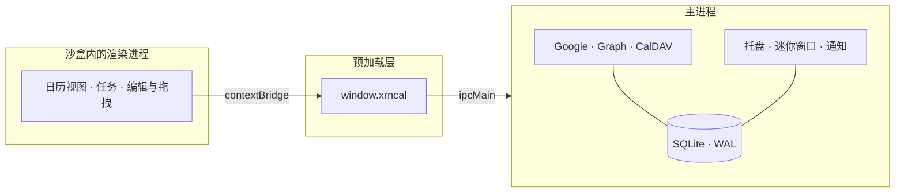

<p align="center">
  
</p>

<h1 align="center">xrncal</h1>

本分支由 immoke 维护。xrncal 由 Xernnn 创建，采用 MIT 许可证。[原项目](https://github.com/Xernnn/xrncal-desktop) · [许可证](LICENSE)

<p align="center">
  <strong>面向 Windows 和 Linux 的本地优先桌面日历。</strong><br>
  在同一窗口使用 Google 日历、Microsoft 365 和 CalDAV，支持农历日期和按农历年份重复的纪念日。
</p>

<p align="center">
  
  
  
  
  
  
  
</p>

<p align="center">
  
</p>

<p align="center">
  <strong>简体中文</strong> · <a href="README.en.md">English</a> · <a href="README.vi.md">Tiếng Việt</a>
</p>

<p align="center">
  <a href="#项目特点">项目特点</a> · <a href="#界面截图">界面截图</a> · <a href="#安装">安装</a> ·
  <a href="#功能">功能</a> · <a href="#架构">架构</a> · <a href="#开发">开发</a>
</p>

---

## 项目特点

### 农历和纪念日

- 日、周、月、年和列表视图均显示农历。简体中文界面采用中国农历，越南语界面采用越南农历，标记初一、十五和春节等日期。
- 可创建按农历年份重复的纪念日，例如「农历八月十二」。应用逐年换算公历日期，处理闰月和小月。
- 纪念日可以生成为同步日历中的普通日程，手机和其他日历客户端也能看到。新建纪念日默认提前一天提醒，并随日程同步。

### 本地数据与离线使用

日历界面读取本机 SQLite。离线时可以查看、新建、修改和删除日程，变更标记为 `dirty = 1`，恢复网络后再上传。

### 在同一窗口使用多个账户

Google 日历、Microsoft 365、Outlook.com 和 CalDAV 可以并行同步。CalDAV 支持 iCloud、Nextcloud、群晖、Fastmail、Radicale 等服务器，各同步引擎独立处理失败。

### 处理同步冲突

支持条件写入的同步操作通过 `If-Match` 检查服务端版本。收到 HTTP `412` 时，应用会标记冲突、暂停上传相关日程，并让用户选择保留哪个版本。

### 加密保存账户信息

OAuth 令牌与 CalDAV 密码通过 Electron `safeStorage` 加密保存。Linux 需要可用的系统密钥环才能持久保存凭据。同步直接连接所配置的服务，使用者可自行管理本地数据，无需注册 xrncal 账户。应用不收集遥测。

### 自建日历视图

五种日历视图由 React 实现，支持拖拽、拉伸边缘和拖选时间段。可设置 15、30 或 60 分钟的对齐步长。拖动到其他日历时，可选择移动或复制。

| 能力 | xrncal |
| --- | --- |
| 农历 | 各视图显示农历日期，支持按农历年份重复 |
| 数据 | 保存到本机 SQLite |
| 离线 | 可查看、新建、修改和删除日程 |
| 多账户 | 同时使用 Google、Microsoft Graph 和 CalDAV |
| 冲突处理 | 暂停相关上传，并显示冲突供用户处理 |
| 只读日历 | 在数据访问层检查日历的写入权限 |

### 界面设计

交互参考 One Calendar（Code Spark）。点击空白时间段可打开完整的日程编辑器。侧栏按账户列出日历，添加账户时按账户类型引导配置。应用也提供农历纪念日、Linux 版、英语和越南语自然语言日期输入、冲突处理及数据库备份。以上功能均免费提供。 [用户需求文档](docs/urd.md)

---

## 界面截图

<table>
<tr>
<td width="50%" valign="top">

<p align="center"><sub>周视图显示第二时区和当前时间线。</sub></p>
</td>
<td width="50%" valign="top">

<p align="center"><sub>年视图用日历颜色标记有日程的日期，日期下方显示农历。</sub></p>
</td>
</tr>
<tr>
<td width="50%" valign="top">

<p align="center"><sub>日程编辑器可设置日历、颜色、时区、提醒、地点、会议链接和参与者。</sub></p>
</td>
<td width="50%" valign="top">

<p align="center"><sub>标题中的农历日期可转换为纪念日，并显示后续日期及提醒。</sub></p>
</td>
</tr>
<tr>
<td width="50%" valign="top">

<p align="center"><sub>按日期分组的列表显示农历和每日的日程数量。</sub></p>
</td>
<td width="50%" valign="top">

<p align="center"><sub>按 <code>/</code> 或 <code>Ctrl+K</code> 打开搜索，支持忽略重音符号。</sub></p>
</td>
</tr>
<tr>
<td width="50%" valign="top">

<p align="center"><sub>添加账户可选择 Google、Microsoft、iCloud、CalDAV、订阅链接、节假日或本机日历。</sub></p>
</td>
<td width="50%" valign="top" align="center">

<p align="center"><sub>可从系统托盘打开迷你窗口，并将其置顶。</sub></p>
</td>
</tr>
</table>

<sub>截图来自 0.2.0 的示例账户和日程。</sub>

---

## 安装

可在 [GitHub 发行页](https://github.com/immoke/xrncal-desktop/releases/latest) 下载对应的平台版本。

- **Windows 10/11 安装版**。运行 `xrncal-Setup-<version>.exe`。未签名的安装包可能触发 SmartScreen 提示，可在确认文件来源后选择「更多信息」和「仍要运行」。
- **Windows 绿色版**。将 `xrncal-<version>-windows-x64-portable.zip` 完整解压到可写目录，运行 `xrncal.exe`。将 `portable.flag` 和其他文件保留在原目录。首次启动会在同目录创建 `xrncal.sqlite`。
- **Linux**。下载 `xrncal-<version>.AppImage`，通过 `chmod +x` 或文件属性赋予执行权限后打开。

首次启动可选择语言、农历、节假日、开机启动及需要接入的日历。安装版可在「设置 → 常规 → 检查更新」管理更新设置。

### 从源码构建

需要 Git 和 Node.js 23.4 或更新版本，推荐使用 Node.js 24。测试使用内置的 `node:sqlite`。

```bash
git clone https://github.com/immoke/xrncal-desktop.git
cd xrncal-desktop
npm install
```

在 Linux 上运行以下命令可构建和安装 AppImage，并添加系统菜单入口。

```bash
npm run app:install
```

安装脚本将 AppImage 放在 `~/Applications/xrncal.AppImage`，将启动器写入 `~/.local/share/applications/xrncal.desktop`。重复运行可更新。已打开的窗口会继续使用启动时的版本，退出重开后加载新版本。启动器从 `~/.cache/xrncal` 中的解包副本运行，在 Wayland 桌面通过 X11 保留迷你窗口的定位和置顶功能。

也可自行构建 AppImage 或 Windows x64 安装包。

```bash
npm run pack:linux
chmod +x dist/xrncal-*.AppImage
./dist/xrncal-*.AppImage

npm run pack:win
```

Windows 安装包位于 `dist/`。如需直接运行源码并启用渲染器热重载，使用 `npm run dev`。

### 连接账户

CalDAV 和 iCloud 需要服务器地址和登录凭据。iCloud 使用 App 专用密码。纯 HTTP 仅适用于本机、专用网络、Tailnet 或本地域名，公网连接使用 HTTPS。

Google 和 Microsoft 通过浏览器进行 OAuth 登录。预置 OAuth 客户端的发行包可直接登录。从源码构建时，也可通过「添加账户 → Google 或 Microsoft」配置自己的 OAuth 客户端。凭据由系统密钥环加密保存。

开发环境可将 `.env.example` 复制为 `.env` 并设置以下参数。自行打包时，也可将同样的配置写到数据目录下的 `xrncal.env`。 [环境变量模板](.env.example) · [部署指南](docs/deployment-guide.md)

```ini
GOOGLE_OAUTH_CLIENT_ID=
GOOGLE_OAUTH_CLIENT_SECRET=
MICROSOFT_CLIENT_ID=
MICROSOFT_CLIENT_SECRET=
```

群晖任务在「任务」工作区添加服务器，填写群晖 Calendar 的 CalDAV 地址和账号。任务服务器与日历账户分别管理。

在首次设置或「添加账户 → 节假日日历」中启用「中国日历（在线）」，即可订阅 ChinaCalendar。 [订阅来源](https://yangh9.github.io/ChinaCalendar/calendar.ics)

### 数据、备份与日志

| 环境 | 数据库路径 |
| --- | --- |
| Linux | `~/.config/xrncal/xrncal.sqlite` |
| Windows 安装版 | `%APPDATA%\xrncal\xrncal.sqlite` |
| Windows 绿色版 | `xrncal.exe` 同目录下的 `xrncal.sqlite` |

- 可在「设置 → 常规」启用自动备份。应用每周备份到同目录的 `backups`，保留最近四份。
- 在设置中可手动导出 SQLite 文件或从备份恢复。恢复前会保存当前数据。备份文件仅供本机用户读取，新版数据库应使用支持该数据库结构的客户端打开。
- 「设置 → 显示日志文件」打开 `xrncal.log` 所在目录。日志记录启动、同步、备份和更新情况，日程正文与密码保存在各自的数据和凭据存储中。
- 从旧版 Gone Calendar 升级时，首次启动会自动复制旧数据，并保留旧配置目录。

---

## 功能

### 日历

- 日、周、月、年和列表视图，支持全天和多日日程、ISO 周数与第二时区。每周可从星期一、星期日或星期六开始。
- 点击空白时间段、日程或「新建」可打开编辑器。支持右键操作、拖拽、调整时长和拖选时间范围。
- 可配置时间对齐步长、编辑器时间列表的步长和默认日程时长。拖选新建时使用选中范围的时长。
- 编辑器支持标题表情，可从英语和越南语标题读取日期、时间和重复规则。保留原文时可取消解析。
- 可修改本次、本次及以后或整个重复系列，也可移动部分重复日程。支持撤销移动、缩放、复制和删除。
- 可在单张 A4 页面打印周历或月历、导出 PDF，并显示农历日期。

### 同步

- Google 日历通过 OAuth 回环和 PKCE 接入，Microsoft 365 与 Outlook.com 通过 Graph 接入，包括 Outlook 中移动、修改或取消的重复日程。
- CalDAV 支持单个重复实例、提醒、参与者和日历颜色同步，并保留其他客户端存入日程中的字段。
- 可回复邀请并订阅 `.ics` 或 `webcal://` 在线日历。订阅每六小时刷新。后台会根据窗口是否聚焦调整同步间隔。
- 每个账户分别显示同步失败原因，可处理服务器冲突。重复提交创建请求时可使用同一日程识别信息防止重复。

### 群晖任务

- 可配置多台群晖任务服务器，按到期日和分类筛选，单独同步某台服务器。
- 在任务页右上角新建任务，设置名称、分类与可选的到期日。
- 任务分为「待办」和「已完成」。勾选完成或恢复待办时，状态同步到群晖。
- 点击任务前的圆圈或双击任务行可以完成或恢复任务。每条任务右侧的「…」可编辑名称、到期日或删除任务。
- 支持新建、改名、修改颜色及删除可编辑的任务分类。

### 桌面工作区

- 关闭窗口后可继续在托盘运行，支持开机启动、置顶迷你窗口和提醒。提醒支持稍后提醒、直接加入会议，并可在重启后恢复。
- 支持浅色、深色和系统主题，可设置强调色、壁纸、模糊和暗度。
- 搜索可忽略重音符号，标题和地点可从历史日程获得建议。
- 每条日程可保留自己的时区和颜色，随 CalDAV 同步或 ICS 导出。支持导入、导出 ICS、备份及恢复 SQLite，也可断开账户并保留本地日程。
- 支持简体中文、英语、越南语和中越农历。初始语言、时间格式及一周首日遵循系统设置。

### 快捷键

| 按键 | 操作 |
| --- | --- |
| `T` | 回到今天 |
| `←` `K` · `→` `J` · `PgUp` `PgDn` | 切换前后周期 |
| `1`–`5` 或 `D` `W` `M` `Y` `L` | 切换日、周、月、年、列表视图 |
| `↑` `↓` · `Enter` | 选择上一个或下一个日程，打开所选日程 |
| `N` 或 `C` · `Del` 或 `⌫` | 新建日程，或删除所选日程 |
| `Shift+↑` `Shift+↓` · `Shift+←` `Shift+→` | 按时间步长或按天移动所选日程 |
| `Alt+↑` `Alt+↓` · `Ctrl+Z` | 调整日程结束时间，或撤销上一步操作 |
| `Ctrl+K` 或 `/` | 搜索 |
| `Ctrl+B` · `Ctrl+P` · `R` | 折叠或展开侧栏、打印或存为 PDF、立即同步 |
| `,` · `?` 或 `F1` | 设置、快捷键说明 |
| `Esc` · `Ctrl+Q` | 关闭对话框或清除选择，退出 xrncal |

在日程编辑器中，`Tab` 切换字段，方向键和 `Enter` 用于选取日期、时间等项目。日期选择器用 `PgUp` 和 `PgDn` 换月，配合 `Shift` 换年。标题栏按 `Enter` 可保存，表单中任意位置可用 `Ctrl+Enter` 保存。使用 `Esc` 可关闭当前选择器或编辑器。

---

## 架构



| 层 | 目录 | 职责 |
| --- | --- | --- |
| 渲染进程 | `src/renderer` | React 视图、编辑器、国际化、主题和迷你窗口 |
| 预加载层 | `src/preload` | 在沙盒中提供类型化的 `window.xrncal` 接口 |
| 主进程 | `src/main` | SQLite 迁移、OAuth、同步、托盘、通知、备份和更新 |
| 共享层 | `src/shared` | IPC 定义、事件模型、农历、节假日、重复规则及标题解析 |

渲染进程通过 IPC 与主进程通信，通道在 `src/shared/ipc-contract.ts` 中定义。主进程校验消息来源，并在数据访问层实施只读日历的写入限制。正式打包停用 Electron 的 Node 模式、`NODE_OPTIONS` 与调试入口。

---

## 开发

```bash
npm run dev
npm run typecheck
npm run lint
npm run test
npm run test:e2e
npm run test:caldav
npm run build
```

- `dev` 启用热重载，`typecheck` 检查主进程和渲染进程，`lint` 运行 ESLint，`build` 将生产构建输出到 `out/`。
- 单元测试使用 Vitest。可用 `npx vitest run tests/expand-occurrences.test.ts` 运行单个文件，或用 `-t "<名称>"` 筛选测试。
- 桌面端到端测试使用 Playwright，需要可用的显示环境。CalDAV 集成测试使用独立的 Radicale，可通过 `XRNCAL_RADICALE` 指定其可执行文件。
- 发行需要更新 `package.json` 中的 `version` 与 `shortVersion`，并使用 `v<shortVersion>` 标签触发 GitHub Actions 打包。项目主页和隐私政策位于 `site/`。 [发行工作流](.github/workflows/release.yml) · [项目站点](https://xernnn.github.io/xrncal-desktop/)

| 文档 | 内容 |
| --- | --- |
| [系统架构](docs/system-architecture.md) | 进程、IPC 与数据流 |
| [代码库概览](docs/codebase-summary.md) | 目录结构和数据库 |
| [代码规范](docs/code-standards.md) | 命名、约定和安全规则 |
| [设计指南](docs/design-guidelines.md) | 颜色、窗口界面和动画 |
| [部署指南](docs/deployment-guide.md) | 构建、打包和 OAuth 注册 |
| [用户需求](docs/urd.md) · [产品设计](docs/project-overview-pdr.md) · [路线图](docs/project-roadmap.md) | 范围和产品决策 |

---

## 许可证

版权归 Xernnn 所有，项目采用 MIT 许可证。发行包的 `resources` 目录包含许可证和第三方声明。应用使用小米的 MiSans Latin 字体。 [MIT 许可证](LICENSE) · [第三方许可声明](THIRD-PARTY-NOTICES.md)

<p align="center">
  <sub>Electron · React · TypeScript · Tailwind · SQLite · Windows &amp; Linux</sub>
</p>

[版本变化（CHANGELOG.immoke.md）](CHANGELOG.immoke.md)
